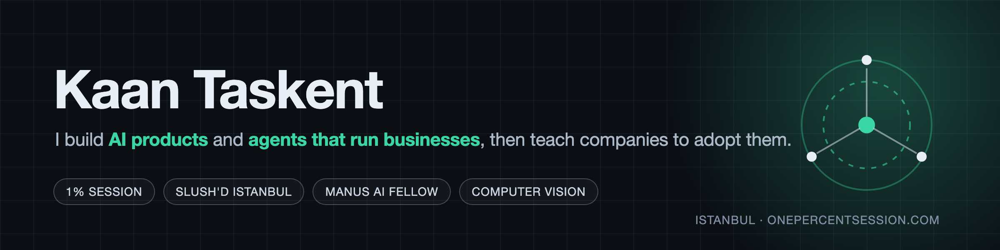

  

  

  
  
  

Founder of [1% Session](https://onepercentsession.com) & Manus AI Fellow.

I find where AI earns its place in a business, then build it into the tools the team already uses. My background is psychology (Georgetown), so I design around how people actually work with agents.

- Trained **1,500+ professionals** and **7 enterprises** on agentic AI
- Won the **Apify x Manus AI x Google Developer Group** agent hackathon
- Ran the **Istanbul Ignited** hackathons, with OpenAI Codex and Manus AI tracks

## Selected work

| | |
| :-- | :-- |
| [**Nexus**](https://github.com/kaantaskentt/nexus) | AI interviews that turn what people know into trust-tagged evidence and workflow maps |
| [**RecordFlow**](https://github.com/kaantaskentt/recordflow) | Record a task once, get evidence-linked steps and an automation-ready spec |
| [**Ultra Vision**](https://github.com/kaantaskentt/ultra-vision) | Local-first computer vision in the browser, including a gesture-controlled DJ mixer |
| [**ContextOS**](https://github.com/kaantaskentt/context-os) | An agent skill that compacts long-running AI memory |
| [**LaunchDeck**](https://github.com/kaantaskentt/launchdeck) | Local-first cockpit to import, inspect and safely preview projects |
| [**Creator Lab**](https://github.com/kaantaskentt/creator-lab) | Research short-form video scripts with Apify and Jev |

## Now

- **1% Session:** programmes that get company teams doing real work with AI
- **The Office:** agents that share my context and hand work to each other
- **Reel Radar:** can agents run a full business, from content to sale?

## How I build

One model builds, another reviews, and nothing ships until a test or a screenshot proves it.

| | |
| :-- | :-- |
| **Agents** | Claude Code, OpenAI Codex, Manus, Playwright, OpenAI Realtime |
| **Data and judgment** | Apify, Firecrawl, Jev, MediaPipe |
| **Product** | TypeScript, Next.js, React, Python, FastAPI, Supabase, Vercel |

  

## Play chess with everyone

One board, the whole internet plays it, one move at a time. It is <!-- BEGIN TURN -->black<!-- END TURN -->'s turn. Click a move below: that opens a pre-filled issue, a GitHub Action plays it, redraws this board and closes the issue. Green is black.

<!-- BEGIN CHESS BOARD -->
|   | H | G | F | E | D | C | B | A |   |
|---|:-:|:-:|:-:|:-:|:-:|:-:|:-:|:-:|:-:|
| **1** |  |  |  |  |  |  |  |  | **1** |
| **2** |  |  |  |  |  |  |  |  | **2** |
| **3** |  |  |  |  |  |  |  |  | **3** |
| **4** |  |  |  |  |  |  |  |  | **4** |
| **5** |  |  |  |  |  |  |  |  | **5** |
| **6** |  |  |  |  |  |  |  |  | **6** |
| **7** |  |  |  |  |  |  |  |  | **7** |
| **8** |  |  |  |  |  |  |  |  | **8** |
|   | **H** | **G** | **F** | **E** | **D** | **C** | **B** | **A** |   |
<!-- END CHESS BOARD -->

**Your move. Pick a piece, click where it goes.**
<!-- BEGIN MOVES LIST -->
|  FROM  | TO (Just click a link!) |
| :----: | :---------------------- |
| **A7** | [A5](https://github.com/kaantaskentt/kaantaskentt/issues/new?body=Please+do+not+change+the+title.+Just+click+%22Submit+new+issue%22.+You+don%27t+need+to+do+anything+else+%3AD&title=Chess%3A+Move+A7+to+A5), [A6](https://github.com/kaantaskentt/kaantaskentt/issues/new?body=Please+do+not+change+the+title.+Just+click+%22Submit+new+issue%22.+You+don%27t+need+to+do+anything+else+%3AD&title=Chess%3A+Move+A7+to+A6) |
| **B7** | [B5](https://github.com/kaantaskentt/kaantaskentt/issues/new?body=Please+do+not+change+the+title.+Just+click+%22Submit+new+issue%22.+You+don%27t+need+to+do+anything+else+%3AD&title=Chess%3A+Move+B7+to+B5), [B6](https://github.com/kaantaskentt/kaantaskentt/issues/new?body=Please+do+not+change+the+title.+Just+click+%22Submit+new+issue%22.+You+don%27t+need+to+do+anything+else+%3AD&title=Chess%3A+Move+B7+to+B6) |
| **B8** | [A6](https://github.com/kaantaskentt/kaantaskentt/issues/new?body=Please+do+not+change+the+title.+Just+click+%22Submit+new+issue%22.+You+don%27t+need+to+do+anything+else+%3AD&title=Chess%3A+Move+B8+to+A6), [C6](https://github.com/kaantaskentt/kaantaskentt/issues/new?body=Please+do+not+change+the+title.+Just+click+%22Submit+new+issue%22.+You+don%27t+need+to+do+anything+else+%3AD&title=Chess%3A+Move+B8+to+C6) |
| **C7** | [C5](https://github.com/kaantaskentt/kaantaskentt/issues/new?body=Please+do+not+change+the+title.+Just+click+%22Submit+new+issue%22.+You+don%27t+need+to+do+anything+else+%3AD&title=Chess%3A+Move+C7+to+C5), [C6](https://github.com/kaantaskentt/kaantaskentt/issues/new?body=Please+do+not+change+the+title.+Just+click+%22Submit+new+issue%22.+You+don%27t+need+to+do+anything+else+%3AD&title=Chess%3A+Move+C7+to+C6) |
| **D7** | [D5](https://github.com/kaantaskentt/kaantaskentt/issues/new?body=Please+do+not+change+the+title.+Just+click+%22Submit+new+issue%22.+You+don%27t+need+to+do+anything+else+%3AD&title=Chess%3A+Move+D7+to+D5), [D6](https://github.com/kaantaskentt/kaantaskentt/issues/new?body=Please+do+not+change+the+title.+Just+click+%22Submit+new+issue%22.+You+don%27t+need+to+do+anything+else+%3AD&title=Chess%3A+Move+D7+to+D6) |
| **E7** | [E5](https://github.com/kaantaskentt/kaantaskentt/issues/new?body=Please+do+not+change+the+title.+Just+click+%22Submit+new+issue%22.+You+don%27t+need+to+do+anything+else+%3AD&title=Chess%3A+Move+E7+to+E5), [E6](https://github.com/kaantaskentt/kaantaskentt/issues/new?body=Please+do+not+change+the+title.+Just+click+%22Submit+new+issue%22.+You+don%27t+need+to+do+anything+else+%3AD&title=Chess%3A+Move+E7+to+E6) |
| **F7** | [F5](https://github.com/kaantaskentt/kaantaskentt/issues/new?body=Please+do+not+change+the+title.+Just+click+%22Submit+new+issue%22.+You+don%27t+need+to+do+anything+else+%3AD&title=Chess%3A+Move+F7+to+F5), [F6](https://github.com/kaantaskentt/kaantaskentt/issues/new?body=Please+do+not+change+the+title.+Just+click+%22Submit+new+issue%22.+You+don%27t+need+to+do+anything+else+%3AD&title=Chess%3A+Move+F7+to+F6) |
| **G7** | [G5](https://github.com/kaantaskentt/kaantaskentt/issues/new?body=Please+do+not+change+the+title.+Just+click+%22Submit+new+issue%22.+You+don%27t+need+to+do+anything+else+%3AD&title=Chess%3A+Move+G7+to+G5), [G6](https://github.com/kaantaskentt/kaantaskentt/issues/new?body=Please+do+not+change+the+title.+Just+click+%22Submit+new+issue%22.+You+don%27t+need+to+do+anything+else+%3AD&title=Chess%3A+Move+G7+to+G6) |
| **G8** | [F6](https://github.com/kaantaskentt/kaantaskentt/issues/new?body=Please+do+not+change+the+title.+Just+click+%22Submit+new+issue%22.+You+don%27t+need+to+do+anything+else+%3AD&title=Chess%3A+Move+G8+to+F6), [H6](https://github.com/kaantaskentt/kaantaskentt/issues/new?body=Please+do+not+change+the+title.+Just+click+%22Submit+new+issue%22.+You+don%27t+need+to+do+anything+else+%3AD&title=Chess%3A+Move+G8+to+H6) |
| **H7** | [H5](https://github.com/kaantaskentt/kaantaskentt/issues/new?body=Please+do+not+change+the+title.+Just+click+%22Submit+new+issue%22.+You+don%27t+need+to+do+anything+else+%3AD&title=Chess%3A+Move+H7+to+H5), [H6](https://github.com/kaantaskentt/kaantaskentt/issues/new?body=Please+do+not+change+the+title.+Just+click+%22Submit+new+issue%22.+You+don%27t+need+to+do+anything+else+%3AD&title=Chess%3A+Move+H7+to+H6) |
<!-- END MOVES LIST -->

  
Last 5 moves

  <!-- BEGIN LAST MOVES -->

| Move | Author |
| :--: | :----- |
| `E2` to `E4` | [ @kaantaskentt](https://github.com/kaantaskentt) |
| `Start game` | [ @kaantaskentt](https://github.com/kaantaskentt) |

<!-- END LAST MOVES -->

---

Say hi on <a href="https://www.linkedin.com/in/kaantaskent">LinkedIn</a> (more active there :)

