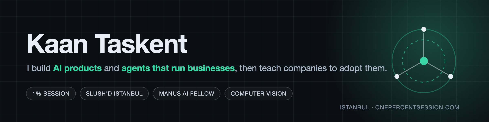

  

  

  
  
  

## About

**Founder of [1% Session](https://onepercentsession.com) · Head of AI at Slush'D Istanbul · Manus AI Fellow**

I find where AI actually earns its place in a business, then build it or wire it into the tools the team already uses. Psychology background (Georgetown), so I care as much about how people work with agents as about the agents themselves.

- **1,500+ professionals and 7 enterprises** trained on agentic AI
- **Hackathon winner** at the Apify x Manus AI x Google Developer Group agent hackathon
- **Ran the Istanbul Ignited hackathons** for Slush'D, with OpenAI Codex and Manus AI tracks

## Now

- **[1% Session](https://onepercentsession.com):** programmes and workshops that get company teams doing real work with AI
- **The Office:** a team of AI agents that share my context and hand work to each other
- **Reel Radar:** can a team of agents run a social channel that sells a product, end to end?

## Featured work

  
  

  
  

  
  

## Play chess with everyone

One board, the whole internet plays it, one move at a time. It is <!-- BEGIN TURN -->black<!-- END TURN -->'s turn. Click a move below: that opens a pre-filled issue, a GitHub Action plays it, redraws this board and closes the issue. Green is black.

<!-- BEGIN CHESS BOARD -->
|   | H | G | F | E | D | C | B | A |   |
|---|:-:|:-:|:-:|:-:|:-:|:-:|:-:|:-:|:-:|
| **1** |  |  |  |  |  |  |  |  | **1** |
| **2** |  |  |  |  |  |  |  |  | **2** |
| **3** |  |  |  |  |  |  |  |  | **3** |
| **4** |  |  |  |  |  |  |  |  | **4** |
| **5** |  |  |  |  |  |  |  |  | **5** |
| **6** |  |  |  |  |  |  |  |  | **6** |
| **7** |  |  |  |  |  |  |  |  | **7** |
| **8** |  |  |  |  |  |  |  |  | **8** |
|   | **H** | **G** | **F** | **E** | **D** | **C** | **B** | **A** |   |
<!-- END CHESS BOARD -->

**Your move. Pick a piece, click where it goes.**
<!-- BEGIN MOVES LIST -->
|  FROM  | TO (Just click a link!) |
| :----: | :---------------------- |
| **A7** | [A5](https://github.com/kaantaskentt/kaantaskentt/issues/new?body=Please+do+not+change+the+title.+Just+click+%22Submit+new+issue%22.+You+don%27t+need+to+do+anything+else+%3AD&title=Chess%3A+Move+A7+to+A5), [A6](https://github.com/kaantaskentt/kaantaskentt/issues/new?body=Please+do+not+change+the+title.+Just+click+%22Submit+new+issue%22.+You+don%27t+need+to+do+anything+else+%3AD&title=Chess%3A+Move+A7+to+A6) |
| **B7** | [B5](https://github.com/kaantaskentt/kaantaskentt/issues/new?body=Please+do+not+change+the+title.+Just+click+%22Submit+new+issue%22.+You+don%27t+need+to+do+anything+else+%3AD&title=Chess%3A+Move+B7+to+B5), [B6](https://github.com/kaantaskentt/kaantaskentt/issues/new?body=Please+do+not+change+the+title.+Just+click+%22Submit+new+issue%22.+You+don%27t+need+to+do+anything+else+%3AD&title=Chess%3A+Move+B7+to+B6) |
| **B8** | [A6](https://github.com/kaantaskentt/kaantaskentt/issues/new?body=Please+do+not+change+the+title.+Just+click+%22Submit+new+issue%22.+You+don%27t+need+to+do+anything+else+%3AD&title=Chess%3A+Move+B8+to+A6), [C6](https://github.com/kaantaskentt/kaantaskentt/issues/new?body=Please+do+not+change+the+title.+Just+click+%22Submit+new+issue%22.+You+don%27t+need+to+do+anything+else+%3AD&title=Chess%3A+Move+B8+to+C6) |
| **C7** | [C5](https://github.com/kaantaskentt/kaantaskentt/issues/new?body=Please+do+not+change+the+title.+Just+click+%22Submit+new+issue%22.+You+don%27t+need+to+do+anything+else+%3AD&title=Chess%3A+Move+C7+to+C5), [C6](https://github.com/kaantaskentt/kaantaskentt/issues/new?body=Please+do+not+change+the+title.+Just+click+%22Submit+new+issue%22.+You+don%27t+need+to+do+anything+else+%3AD&title=Chess%3A+Move+C7+to+C6) |
| **D7** | [D5](https://github.com/kaantaskentt/kaantaskentt/issues/new?body=Please+do+not+change+the+title.+Just+click+%22Submit+new+issue%22.+You+don%27t+need+to+do+anything+else+%3AD&title=Chess%3A+Move+D7+to+D5), [D6](https://github.com/kaantaskentt/kaantaskentt/issues/new?body=Please+do+not+change+the+title.+Just+click+%22Submit+new+issue%22.+You+don%27t+need+to+do+anything+else+%3AD&title=Chess%3A+Move+D7+to+D6) |
| **E7** | [E5](https://github.com/kaantaskentt/kaantaskentt/issues/new?body=Please+do+not+change+the+title.+Just+click+%22Submit+new+issue%22.+You+don%27t+need+to+do+anything+else+%3AD&title=Chess%3A+Move+E7+to+E5), [E6](https://github.com/kaantaskentt/kaantaskentt/issues/new?body=Please+do+not+change+the+title.+Just+click+%22Submit+new+issue%22.+You+don%27t+need+to+do+anything+else+%3AD&title=Chess%3A+Move+E7+to+E6) |
| **F7** | [F5](https://github.com/kaantaskentt/kaantaskentt/issues/new?body=Please+do+not+change+the+title.+Just+click+%22Submit+new+issue%22.+You+don%27t+need+to+do+anything+else+%3AD&title=Chess%3A+Move+F7+to+F5), [F6](https://github.com/kaantaskentt/kaantaskentt/issues/new?body=Please+do+not+change+the+title.+Just+click+%22Submit+new+issue%22.+You+don%27t+need+to+do+anything+else+%3AD&title=Chess%3A+Move+F7+to+F6) |
| **G7** | [G5](https://github.com/kaantaskentt/kaantaskentt/issues/new?body=Please+do+not+change+the+title.+Just+click+%22Submit+new+issue%22.+You+don%27t+need+to+do+anything+else+%3AD&title=Chess%3A+Move+G7+to+G5), [G6](https://github.com/kaantaskentt/kaantaskentt/issues/new?body=Please+do+not+change+the+title.+Just+click+%22Submit+new+issue%22.+You+don%27t+need+to+do+anything+else+%3AD&title=Chess%3A+Move+G7+to+G6) |
| **G8** | [F6](https://github.com/kaantaskentt/kaantaskentt/issues/new?body=Please+do+not+change+the+title.+Just+click+%22Submit+new+issue%22.+You+don%27t+need+to+do+anything+else+%3AD&title=Chess%3A+Move+G8+to+F6), [H6](https://github.com/kaantaskentt/kaantaskentt/issues/new?body=Please+do+not+change+the+title.+Just+click+%22Submit+new+issue%22.+You+don%27t+need+to+do+anything+else+%3AD&title=Chess%3A+Move+G8+to+H6) |
| **H7** | [H5](https://github.com/kaantaskentt/kaantaskentt/issues/new?body=Please+do+not+change+the+title.+Just+click+%22Submit+new+issue%22.+You+don%27t+need+to+do+anything+else+%3AD&title=Chess%3A+Move+H7+to+H5), [H6](https://github.com/kaantaskentt/kaantaskentt/issues/new?body=Please+do+not+change+the+title.+Just+click+%22Submit+new+issue%22.+You+don%27t+need+to+do+anything+else+%3AD&title=Chess%3A+Move+H7+to+H6) |
<!-- END MOVES LIST -->

  
Last 5 moves

  <!-- BEGIN LAST MOVES -->

| Move | Author |
| :--: | :----- |
| `E2` to `E4` | [ @kaantaskentt](https://github.com/kaantaskentt) |
| `Start game` | [ @kaantaskentt](https://github.com/kaantaskentt) |

<!-- END LAST MOVES -->

## How I build

I run a small team of AI agents the way a founder runs a startup: Claude plans and reviews, Codex builds, a judgment model scores the calls, and nothing ships until a test or a screenshot proves it.

| Layer | What I use | What it does for me |
| :-- | :-- | :-- |
| **Agents that build** | Claude Code, OpenAI Codex | Two models, one builds and the other reviews. Neither grades its own work. |
| **Agents that act** | Manus, Playwright, OpenAI Realtime | Browse, fill forms, talk by voice, run whole workflows end to end |
| **Judgment** | Jev (TypeSafe) | Typed yes/no and scores in under a second, for calls I don't want an LLM to ramble about |
| **Eyes** | MediaPipe, local vision models | Gestures, hands and faces, running in the browser with nothing sent to a server |
| **Data in** | Apify, Firecrawl, public APIs | Turn the open web into clean rows my agents can reason over |
| **Media out** | fal.ai, Higgsfield | Images and video generated on demand inside the product |
| **Product** | Next.js, TypeScript, React, Tailwind | The part people actually touch |
| **Backbone** | Supabase, Postgres, FastAPI, Vercel, GitHub Actions | Auth, data and deploys, plus cron agents that commit their own work |

  

## GitHub

  
  

## Say hi

I'm in Istanbul. If you run a team that should be using AI for real work, or you're building agents and want to compare notes, my inbox is open.

[LinkedIn](https://www.linkedin.com/in/kaantaskent) · [onepercentsession.com](https://onepercentsession.com) · [Slush'D Istanbul](https://istanbulslushd.com)
